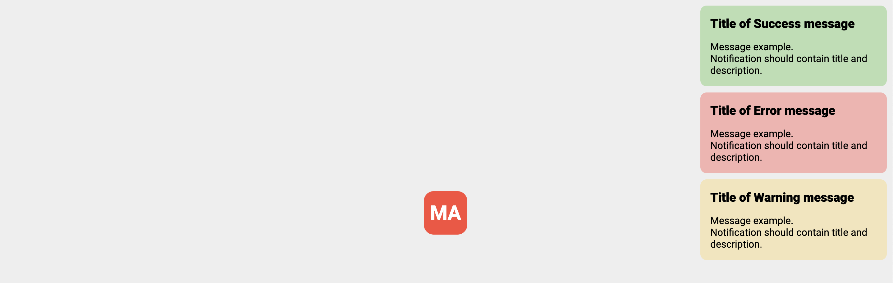

## Task: Create a notification

To inform the user about the success of the operation or any errors, websites typically use messages that appear on the screen for a short period.

Your task: Create a function `pushNotification`, which takes the coordinates of the message, title, description, and type 
(success, error and warning). `pushNotification` creates an element to display the message, appends it to the document, and hides it from the DOM after 2 seconds.
Do not write any CSS styles or HTML code in this task. You should modify only the `main.js` file.

Implementation guideline:
- Print three messages: `success`, `error`, `warning` (call methods already exist in the `main.js` file);
- The message is a block element with class `notification` + class, which depends on the input parameter type (`success`, `error`, `warning`); 
- The message should have a title with class `title` (prefer `h2` element);
- The message should have a description (prefer tag `p`);
- Use [setTimeout](https://developer.mozilla.org/en-US/docs/Web/API/WindowOrWorkerGlobalScope/setTimeout) to execute a function or specified piece of code once the timer expires;
- **Important:** Do not remove elements from the DOM in this task; instead, use style attributes just to hide messages visually (f.e, `display` or `visibility` properties).

It's an expected result of your job:

Щоб повідомити користувача про успіх операції або будь-які помилки, веб-сайти зазвичай використовують повідомлення, які з'являються на екрані протягом короткого періоду.

Ваше завдання: Створіть функцію `pushNotification`, яка приймає координати повідомлення, заголовок, опис та тип `(success, error та warning). `pushNotification` створює елемент для відображення повідомлення, додає його до документа та приховує його з DOM через 2 секунди.
Не пишіть жодних стилів CSS чи HTML-коду в цьому завданні. Вам слід змінити лише файл `main.js`.

Рекомендація щодо реалізації:
- Виведіть три повідомлення: `success`, `error`, `warning` (методи виклику вже існують у файлі `main.js`);
- Повідомлення є блоковим елементом з класом `notification` + клас, який залежить від типу вхідного параметра (`success`, `error`, `warning`);
- Повідомлення повинно мати заголовок з класом `title` (бажано елемент `h2`);
- Повідомлення повинно мати опис (бажано використовувати тег `p`);
- Використовуйте [setTimeout](https://developer.mozilla.org/en-US/docs/Web/API/WindowOrWorkerGlobalScope/setTimeout) для виконання функції або вказаного фрагмента коду після закінчення часу таймера;
- **Важливо:** Не видаляйте елементи з DOM у цьому завданні; натомість використовуйте атрибути стилю лише для візуального приховування повідомлень (наприклад, властивості `display` або `visibility`).

Це очікуваний результат вашої роботи:

### General instructions

1. Replace `<your_account>` with your GitHub username in the link
    - [DEMO LINK](https://ElinaMrachkovska.github.io/js_notification_DOM/)
2. Follow [this instructions](https://mate-academy.github.io/layout_task-guideline/)
    - Run `npm run test` command to test your code;
    - Run `npm run test:only -- -n` to run fast test ignoring linter;
    - Run `npm run test:only -- -l` to run fast test with additional info in console, ignoring linter.
